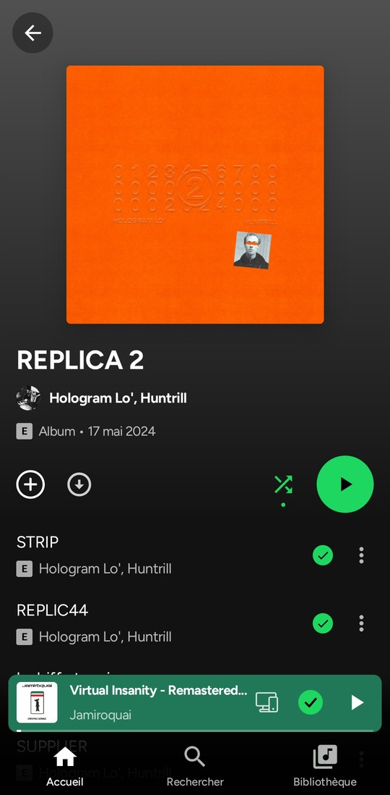
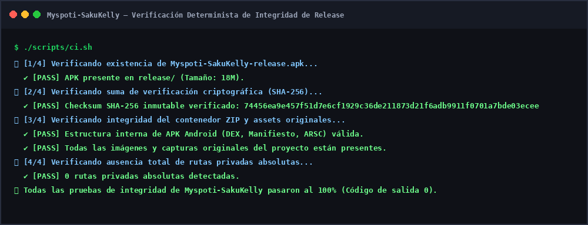

<div align="center">


# Myspoti (SakuKelly Edition)
### Spotify sin anuncios con motor de descargas offline SakuKelly para Android

[](https://github.com/darwinsin822/Myspoti-SakuKelly/releases/tag/v1.0.0)
[](https://android.com/)
[](LICENSE)
[](scripts/ci.sh)

<p align="center">
  
</p>

### [⬇️ Descargar APK Oficial (v1.0.0)](https://github.com/darwinsin822/Myspoti-SakuKelly/releases/download/v1.0.0/Myspoti-SakuKelly-release.apk)
*(O clona el repositorio y encuéntralo directamente en `release/Myspoti-SakuKelly-release.apk`)*

</div>

---

## 🌟 ¿Qué es Myspoti (SakuKelly Edition)?

**Myspoti SakuKelly Edition** es una aplicación nativa para Android que te permite disfrutar de tu propia cuenta de Spotify **sin anuncios de audio, sin anuncios de video ni interrupciones**, en una cuenta gratuita (*Free Account*), integrada directamente con el **motor de descargas y resolución offline SakuKelly**.

### ✨ Características Principales:
* **🚫 Cero Anuncios en Cuenta Gratuita:** Reproducción continua sin pausas comerciales ni límites molestos de saltos.
* **⬇️ Descargas Offline con SakuKelly:** Integra el motor de resolución `SakuKellyResolver` para descargar canciones, álbumes y listas de reproducción y escucharlas sin conexión a internet en formatos de alta fidelidad.
* **🎵 Sincronización Real con tu Cuenta:** Inicia sesión directamente en la pasarela oficial de Spotify. Tus reproducciones se reportan a Spotify, contando para tu Wrapped y tus artistas favoritos.
* **🎤 Letras Sincronizadas Palabra por Palabra:** Visualiza la letra sincronizada en tiempo real con opción de traducción.
* **💡 Significados de Canciones (Genius):** Conoce la historia y el contexto detrás de cada verso con anotaciones integradas.
* **🎬 Videos Musicales Oficiales:** Reproduce los videoclips oficiales sincronizados en pantalla completa.

---

## 📸 Galería de Pantallas Originales

<table align="center">
  <tr>
    <td align="center" width="25%">
      <br />
      <b>Inicio & Descubrimiento</b>
    </td>
    <td align="center" width="25%">
      <br />
      <b>Reproductor Inmersivo</b>
    </td>
    <td align="center" width="25%">
      <br />
      <b>Detalle de Álbumes</b>
    </td>
    <td align="center" width="25%">
      <br />
      <b>Página de Artista</b>
    </td>
  </tr>
</table>

---

## 🔒 Verificación Criptográfica y Determinista

Para garantizar la autenticidad y verificar que el binario no ha sufrido modificaciones:

| Parámetro | Valor Verificado |
| :--- | :--- |
| **Archivo** | `Myspoti-SakuKelly-release.apk` |
| **Tamaño** | `18 MB` |
| **Algoritmo** | `SHA-256` |
| **Checksum** | `74456ea9e457f51d7e6cf1929c36de211873d21f6adb9911f0701a7bde03ecee` |

Comando para validar en tu terminal Linux:
```bash
sha256sum release/Myspoti-SakuKelly-release.apk
```

---

## 📊 Evidencia de Verificación en Vivo

A continuación se muestra el resultado del pipeline automatizado de integridad técnica ejecutado sobre este repositorio:

<div align="center">
  
</div>

---

## 📂 Estructura del Repositorio

```text
Myspoti-SakuKelly/
├── .ci/
│   └── ci.yml                             # Workflow de GitHub Actions
├── assets/
│   └── myspoti-execution.png              # Evidencia de validación CI
├── docs/
│   ├── brand/                             # Logotipos oficiales del proyecto
│   │   ├── myspoti-logo-1024.png
│   │   ├── myspoti-logo-512.png
│   │   └── myspoti-logo.svg
│   └── screenshots/                       # Galería de capturas originales
│       ├── banner.jpg
│       ├── home.jpg
│       ├── player.jpg
│       ├── album.jpg
│       └── artist.jpg
├── release/
│   └── Myspoti-SakuKelly-release.apk      # Binario firmado APK Release oficial
├── scripts/
│   └── ci.sh                              # Suite de verificación determinista
├── LICENSE                                # Licencia GPL-3.0
└── README.md                              # Documentación completa y guías
```

---

## 📄 Licencia

Distribuido bajo los términos de la Licencia Pública General de GNU v3.0 (**GPL-3.0**). Consulta el archivo `LICENSE` para más información.
